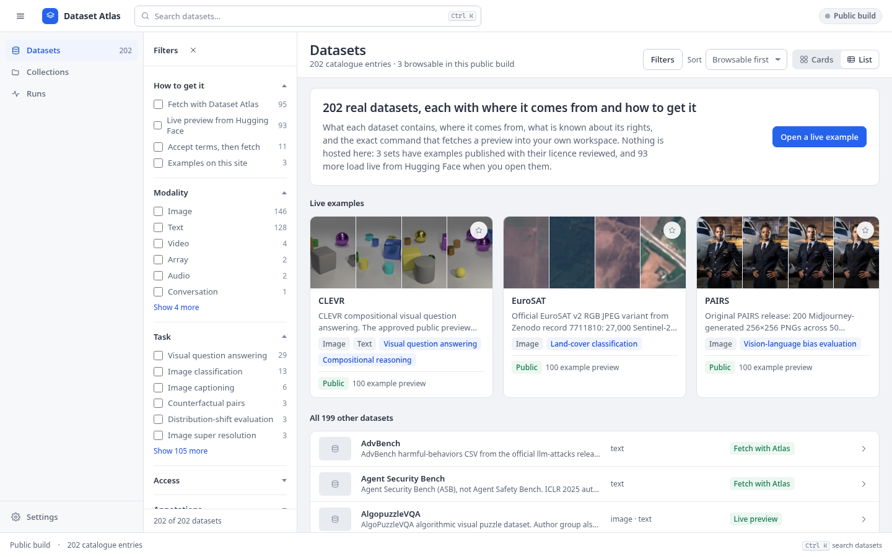
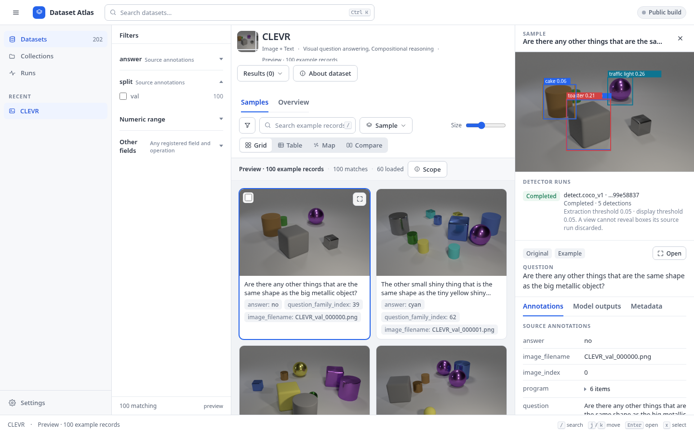

# Dataset Atlas

Explore original datasets through one catalogue, with provenance, native annotations,
linked media, reproducible selections and optional local analysis. Dataset Atlas 1.0
supports declared, pinned source populations; every page identifies the population
it can actually show or query.



Clone the repository and open the approved sample browser:

```bash
git clone --depth 1 https://github.com/shinobiultra/DatasetAtlas.git
cd DatasetAtlas
./start.sh
```

Install [uv](https://docs.astral.sh/uv/getting-started/installation/) and Node.js 26 (or 22.12+)
first. Setup uses locked dependencies and builds the interface. The browser includes
300 real examples from CLEVR, EuroSAT and PAIRS, with their approved original media,
annotations and provenance. It needs no model, GPU or maintainer dataset directory;
the included examples work offline after setup.

For a smaller handoff, download the [sample ZIP](https://github.com/shinobiultra/DatasetAtlas/releases/latest/download/dataset-atlas-samples.zip)
(about 29 MB), extract it, open the `dataset-atlas-sample` folder and run
`python3 OPEN_ATLAS.py`. It needs only Python 3.11+ and checks every bundled file
before opening. See [sharing with colleagues](docs/sharing.md).

Run `./start.sh --workbench` for your own local workspace. Dataset pages show the
pinned source, transfer and storage plan before preparation. Fetch only the sources
you need, with your own access and explicit budgets. Add local folders, tables or
Hugging Face datasets alongside the catalogue. Original source files remain intact.



Grid, table, compare and 2D/3D maps share filters and selections. Native example
relationships and media conditions stay linked. Complete local indices support
exact counts over their declared partitions; previews retain their sample scope.
Large-source sampling uses pinned populations and explicit budgets rather than
implying that a small preview is a complete local index.

Analysis is optional: detectors, embeddings, projections, clustering, outliers and
local model conversations use the selected population. Browsing needs no GPU.
Install optional dependencies and weights explicitly; model context is reviewed
before sending. No external model is connected automatically.

The [current release status](reports/final-status.json), [verification evidence](reports/release_evidence.md),
[coverage matrix](reports/dataset_coverage.csv) and [source pins](reports/catalogue-sources.json)
are generated from the active runtime catalogue. [Source and rights qualifications](reports/limitations.md)
keep source scope, historical paper use, publication rights and human acceptance
separate from software verification. Public media is limited to the exact approved
CLEVR, EuroSAT and PAIRS packs.

[Getting started](docs/getting-started.md) · [Documentation](docs/README.md) ·
[Development](docs/development.md) · [Publication](docs/publication.md) ·
[Release scope](ROADMAP.md) · [SPEC](SPEC.md)

The code uses the [MIT licence](LICENSE). Dataset licences and notices remain those
of their publishers; see `registry/` and `licenses/`. Access to a source does not
provide permission to redistribute it.
